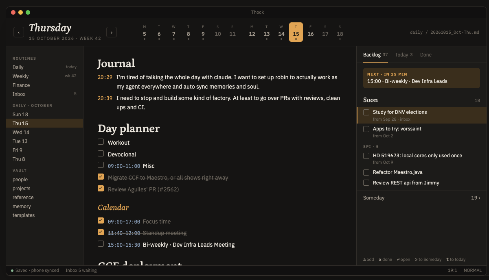

# Thock V43 - Almanac: a desk set in type

**Status:** Draft (2026-10-18)
**Owner:** Diego · **Date:** 2026-10-18
**Design reference:** the three directions this spec chose from (A, *Almanac*), with live mockups
and the theme switcher: <https://claude.ai/artifact/6TKpMJ2dQ1mi5XaScvXido>. The approved frame is
checked in beside this file as `v43-almanac-reference.png`.
**Companion docs:** `v10-markdown-conceal.md` and `v24-inline-markdown-conceal.md` (the conceal
layer the heading blocks extend), `v39-vault-images.md` §4 (the block machinery), `v4-day-planner-panel.md`
and `v8-calendar-sync.md` (what Today shows and where the Next card reads from), `v6-backlog.md`
and `v17-backlog-categories.md` (the Backlog model and keys this re-lays out), `v33-iphone-companion.md`
§13 (the phone's visual language this borrows from), `v12-de-zed-ification.md` (chrome already removed)



---

## 1. Summary

Thock still looks like Zed: One Dark, a monospace buffer with line numbers, a breadcrumb for a
title, and the Backlog eating the bottom third of the window. V43 gives the desk its own look,
taken from the phone app's palette and type, without bringing over any phone-only flows.

Four changes, each shippable alone:

1. **A Thock theme** (Dark and Light) built from the phone's tokens. It becomes the default, and
   One Dark / One Light stay in the theme picker.
2. **A masthead** under the window title: the day in Petrona italic, back and forward buttons,
   and a two-week strip that shows which days have notes. The file path is moved to the right
   in small mono.
3. **A Desk panel in the right dock** that replaces the bottom-dock Backlog and the Day Planner
   panel. It has three tabs (Backlog, Today, Done), and a Next card keeps the coming event in view.
4. **Typeset notes:** vault notes are set in IBM Plex Sans, and `#` / `##` headings are drawn in
   Petrona by the conceal layer. Line numbers are off.

## 2. Goals & success criteria

- Opening a vault shows the reference frame: masthead, notes in Plex Sans with Petrona headings,
  Desk panel on the right, nothing in the bottom dock.
- The viewed day is always the largest text on screen, and moving one day back or forward is one
  chord (`cmd-alt-[` / `cmd-alt-]`) or one click.
- The file name is still visible, at 11px, and never competes with the date.
- Switching to One Dark gives a coherent Zed-familiar look with the same layout. Nothing in
  V43 assumes the Thock theme is active.
- Every new surface is fully keyboard-operable (CLAUDE.md "Panels"), with vim motions.
- No byte of a note changes. Headings, times and checkboxes are display-only, as in V10.
- Each surface uses at most three families: Petrona, IBM Plex Sans, Lilex.

## 3. Non-goals

- **The left column.** The reference shows a restyled Routines rail with a "Daily · October"
  list. V43 only applies the theme and font tokens to the existing rail. A dated list of notes is
  a follow-up, and most of its job is already done by the strip.
- **Phone flows.** No swipe gestures, sheets, chips or bottom tab bar. The desk keeps panes, keys
  and the command palette.
- **Proposals B and C.** No baseline grid, no serif body text, no overlay drawers.
- **Changing the Backlog's file format, its writes, or the Day Planner's parsing.** The Desk panel
  is a new layout over the same models.
- **Translating the masthead's month and weekday names.** It uses English, like the rest of the
  chrome (V19).

## 4. Typography

### 4.1 Families

| Role | Family | Cuts shipped | Where |
| --- | --- | --- | --- |
| Display | **Petrona** | Regular 400, Medium Italic 500, SemiBold 600 | Masthead weekday, `#`/`##` headings, Desk lane titles |
| Text and UI | **IBM Plex Sans** (`.ZedSans`) | Regular 400, Italic, SemiBold 600, SemiBold Italic (already embedded) | Note body, every panel, masthead labels and numerals |
| Utility | **Lilex** (`.ZedMono`) | Regular, Italic, Bold, Bold Italic (already embedded) | File path, code in panels, source mode |

Petrona is the phone's display face (`thock/ios/Shared/Fonts/Petrona.ttf`), but the phone ships
the variable file and picks a weight through the `wght` axis. GPUI chooses a face by family,
weight and style, so the desk ships **static cuts** under `assets/fonts/petrona/` with its
`OFL.txt`. `load_embedded_fonts` (`crates/zed/src/main.rs`) already embeds every `.ttf` under
`assets/fonts`, so adding the files is enough. Plex Sans ships 400 and 600 only, and this spec
sticks to those two weights rather than adding a Medium cut.

GPUI has no letter-spacing. The phone's tracked small caps become plain uppercase at 11px
SemiBold in `text.muted` or `text.placeholder`. Digits that line up (strip numerals, times,
counts) turn on Plex Sans's `tnum` feature through `FontFeatures`.

### 4.2 Scale

Sizes are given at the shipped defaults (`ui_font_size` 16, `buffer_font_size` 17). Panel and
masthead sizes are in rems of the UI size and editor sizes are multiples of the buffer size
(**B**), so both scale with the user's settings.

| Token | Family / cut | Size | Example |
| --- | --- | --- | --- |
| `masthead.weekday` | Petrona Medium Italic | 1.75rem (28px), line height 1 | *Thursday* |
| `masthead.date` | Plex Sans SemiBold, uppercase, `tnum` | 0.6875rem (11px) | 15 OCTOBER 2026 · WEEK 42 |
| `strip.initial` | Plex Sans SemiBold, uppercase | 0.625rem (10px) | T |
| `strip.numeral` | Plex Sans SemiBold, `tnum` | 0.9375rem (15px) | 15 |
| `masthead.path` | Lilex Regular | 0.6875rem (11px) | daily / 20261015_Oct-Thu.md |
| `note.body` | Plex Sans Regular, `tnum` | B (17px), `comfortable` line height (1.618 → 27.5px row) | I need to stop and build some kind of factory. |
| `note.h1` | Petrona SemiBold | 1.75B (30px), drawn in a 2-row block | **Day planner** |
| `note.h2` | Petrona Medium Italic | 1.3B (22px), drawn in a 1-row block | *Calendar* |
| `note.h3` | Plex Sans SemiBold (highlight only) | B | Reminder |
| `note.time` | Plex Sans SemiBold, `tnum` (highlight) | B | 20:29 |
| `lane.title` | Petrona SemiBold | 1.0625rem (17px) | Soon |
| `lane.caption` | Plex Sans SemiBold, uppercase | 0.6875rem (11px) | SPI · 5 |
| `row.text` | Plex Sans Regular | 0.875rem (14px), wraps to 2 lines | Study for DNV elections |
| `row.meta` | Plex Sans Regular | 0.71875rem (11.5px) | from Sep 28 · inbox |
| `tab.label` | Plex Sans Regular / SemiBold when active | 0.8125rem (13px) | Backlog 37 |
| `keys.hint` | Plex Sans Regular + `ui::KeyBinding` | 0.6875rem (11px) | `x` done |

## 5. Color: the Thock theme

A new theme family in `assets/themes/thock/thock.json`, with **Thock Dark** and **Thock Light**,
built from `thock/ios/Shared/Theme.swift`. The default `theme` setting
(`assets/settings/default.json`) becomes `{"mode": "system", "dark": "Thock Dark", "light": "Thock Light"}`.
One Dark and One Light stay as they are. A user who already chose a theme keeps it.

### 5.1 Tokens

| Token | Dark | Light | Theme keys |
| --- | --- | --- | --- |
| ground | `#151413` | `#F3EFE7` | `background`, `editor.background`, `editor.gutter.background` |
| surface | `#1C1B19` | `#FAF7F1` | `panel.background`, `surface.background`, `elevated_surface.background`, `tab_bar.background`, `toolbar.background` |
| sunken | `#111010` | `#EBE6DC` | `title_bar.background`, `status_bar.background`, `editor.subheader.background` |
| rule | `#322E2A` | `#D9D1C3` | `border`, `panel.focused_border`, `pane.focused_border` |
| ruleSoft | `#262320` | `#E7E1D6` | `border.variant`, `editor.wrap_guide` |
| ink | `#ECE7DE` | `#1C1B19` | `text`, `editor.foreground`, `icon` |
| muted | `#A89F93` | `#5F594F` | `text.muted`, `icon.muted` |
| dim | `#6D675E` | `#978F82` | `text.placeholder`, `text.disabled`, `editor.line_number` |
| amber | `#E2A554` | `#A8711F` | `text.accent`, `icon.accent`, `border.focused`, `editor.active_line_number`, `players[0].cursor` |
| amberSoft | `#3A2E1C` | `#F1E3C9` | `element.selected`, `ghost_element.selected`, `players[0].selection` (at 70%) |
| amberInk | `#171613` | `#FAF7F1` | text on a filled amber surface (today cell, checked box) |
| cal | `#8FA5C0` | `#4F6A8C` | `syntax.link_uri`, `info`, calendar times |
| good | `#86B48F` | `#3F7A4F` | `success`, `created` |
| warn | `#E08A5A` | `#B2541F` | `warning`, `modified` |

Two derived tones that the phone doesn't need: `editor.active_line.background` is ink at 4%, and
`error` is `#E07A6A` (dark) / `#A8402F` (light). Terminal ANSI colours come from One Dark / One
Light, with background and foreground swapped for ground and ink.

### 5.2 Where amber goes

The phone's rule is that amber means the agent and the primary action, and nothing else (V33 §13).
The desk adds one meaning, **where you are**: today in the strip, the selected row, the caret, the
Next card, the active tab underline, and journal times. It also keeps the reference's amber
italic `##`, which is the only typographic use. Calendar times stay `cal`, and links follow the
existing rules (wikilinks `text.accent`, external links `syntax.link_uri`).

### 5.3 Heading colours become theme-addressable

Today `markdown_conceal::slot_color` takes heading colours from `players[1..]`. That ties
headings to the Day Planner's section palette, and a theme can't control weight or slant through
it. V43 reads the syntax styles `title.h1`, `title.h2` and `title.h3` first (colour, `font_weight`,
`font_style`) and falls back to the player slots when a theme doesn't define them. One Dark and
One Light don't define them, so they look exactly as they do today.

```json
"title.h1": { "color": "#ECE7DE", "font_weight": 600 },
"title.h2": { "color": "#E2A554", "font_style": "italic" },
"title.h3": { "color": "#A89F93", "font_weight": 600 }
```

## 6. The masthead

### 6.1 Layout

The masthead is a 72px row directly under the platform title bar, across the full window width,
on `title_bar.background`, with a 1px `border` below and 20px side padding. It has three zones:

```
┌──────────────────────────────────────────────────────────────────────────────────────┐
│ ‹  Thursday            ›   M  T  W  T  F  S  S    M  T  W  [T] F  S  S   daily / 2026…│
│    15 OCTOBER 2026 · WEEK 42  5  6  7  8  9 10 11  12 13 14 [15] 16 17 18             │
│                            •  •  •  •  •           •  •  [•]       •                  │
└──────────────────────────────────────────────────────────────────────────────────────┘
  date block (min 260px)       strip (centred on the window)            path (right)
```

- **Date block:** a 24×24 nav button (`IconName::ChevronLeft`, 1px `border`, radius 5,
  `icon.muted`), the weekday (`masthead.weekday`) above the date line (`masthead.date`), then the
  forward button, with 16px between each. Both buttons are `IconButton`s with tooltips that name
  their target ("Wed 14", "Fri 16").
- **Strip:** 14 cells covering two ISO weeks: the viewed date's week and the week before it, or
  the viewed week and the week after when today falls there, so looking at last week never
  pushes today out of the strip. Each cell is 40px wide with 4px between cells and 20px between
  the two weeks, and holds the initial, the numeral and a 4px dot when a daily note exists for
  that day. Weekend cells are drawn at 55% opacity.
- **Path:** the active item's vault-relative path, with separators shown as ` / `, in
  `masthead.path` and `text.placeholder`. Clicking it reveals the file in the project panel.

Cell states:

| State | Treatment |
| --- | --- |
| Today | Filled amber, radius 6, text and dot in amberInk |
| Viewed (not today) | 1px amber border, radius 6 |
| Has a note | ink numeral, dim dot |
| Past day with no note | dim numeral, no dot, not clickable (tooltip "No note on Mon 12") |
| Future after tomorrow | dim numeral, not clickable |

### 6.2 What it shows for each kind of note

| Active item | Weekday line | Date line | Strip |
| --- | --- | --- | --- |
| Daily note (`Vault::daily_note_date` resolves) | *Thursday* | 15 OCTOBER 2026 · WEEK 42 | That day's two weeks, the day outlined |
| Weekly note | *Week 42* | 12 – 18 OCTOBER 2026 | That week, all seven cells outlined |
| Any other note, or no item | Today's weekday | Today's date | Today's two weeks |

So the masthead always shows a day, and the path is the only thing that changes when you open
`backlog.md`.

### 6.3 Navigation

| Action (`thock::`) | macOS | Linux | Behaviour |
| --- | --- | --- | --- |
| `OpenPreviousDay` | `cmd-alt-[` | `ctrl-alt-[` | Opens the nearest existing daily note before the viewed day. Empty days are skipped, so browsing never creates past notes. |
| `OpenNextDay` | `cmd-alt-]` | `ctrl-alt-]` | Opens the nearest existing note after the viewed day. If there is none up to today, opens today (create-if-missing). From today, opens tomorrow, like `OpenTomorrow`. |
| `OpenToday` (exists, unbound) | `cmd-alt-d` | `ctrl-alt-home` (`ctrl-alt-d` is `editor::DeleteToNextSubwordEnd`) | Unchanged |
| `FocusDayStrip` | `cmd-alt-w` | `ctrl-alt-w` | Focuses the strip on the viewed day |

In the strip (key context `ThockDayStrip`, with `menu`): `left`/`right` and `h`/`l` move by a day,
skipping disabled cells, `up`/`down` and `k`/`j` move by a week, `enter` opens the day, and
`escape` returns focus to the editor. The focused cell gets a 2px `border.focused` ring.

Examples, with today Thu 15 Oct and notes on 13, 14, 15 and 18:

- Viewing Thu 15, `cmd-alt-[` opens Wed 14.
- Viewing Tue 13, `cmd-alt-[` opens Fri 9, skipping the empty Sat 10 to Mon 12.
- Viewing Wed 14, `cmd-alt-]` opens Thu 15.
- Viewing Thu 15, `cmd-alt-]` opens Sun 18, because that note exists.
- With `backlog.md` active, `cmd-alt-[` opens Wed 14, because navigation starts from today.

### 6.4 Narrow windows

Below 1000px window width the strip shows only the viewed week (7 cells). Below 760px the strip
is hidden and the date block and path remain. The path truncates from the start
(`… / 20261015_Oct-Thu.md`).

### 6.5 Where it lives

The masthead is a GPUI view in `crates/thock/src/masthead.rs` and is rendered as a second row of
the existing `title_bar::TitleBar`. This is a small edit to the inherited `title_bar` crate: an
`Option<AnyView>` field, a `set_masthead` setter, and a column around the current render. Thock
sets the masthead in its workspace observer. Wrapping `TitleBar` in a new titlebar item would
break the `downcast::<TitleBar>()` calls in `title_bar.rs`, and keeping `TitleBar` keeps the
Linux application menu and window controls. The title bar row keeps its current height and
contents, with the window title ("Thock") centred and Zed's chrome already hidden by V12.

## 7. Notes

### 7.1 Body text

In a vault Markdown editor with conceal on, `MarkdownConcealAddon` sets a
`TextStyleRefinement` (`Editor::set_text_style_refinement`) with the body family and `tnum`. A
`thock` block in `settings.json` controls the faces, and a change applies to open notes right
away, like `buffer_font_family`:

```json
"thock": {
  "body_font": "IBM Plex Sans",   // "buffer" uses your editor font
  "heading_font": "Petrona"       // "body" draws headings in the body font
}
```

`ThockSettings` (`crates/thock/src/thock.rs`) reads the block, the conceal addon re-applies the
refinement on every settings change, and heading blocks read their face at render time. The
fonts are a user preference rather than a vault property, so they are not in the vault's
`config.toml`: a dev who wants notes in mono sets `"body_font": "buffer"` once, for every vault.

With **toggle markdown source** (`cmd-alt-m`) the refinement is dropped, so the source shows in
Lilex. That makes it obvious you are looking at source.

A column count means nothing in a proportional face: the editor measures the wrap guide in
spaces and the wrap width in `m`s, so a `bounded` soft wrap puts the guide mid-screen while the
text wraps at the editor's edge. While the body face is on, the addon overrides soft wrap to
`editor_width` and hides wrap guides; the source view gets the user's wrap settings back, and so
does `"body_font": "buffer"`.

Prose is laid out with `soft_wrap: "editor_width"` and centred layout on by default for vault
workspaces, with padding chosen so that the measure is about 680px at a 1440px window
(about 72 characters of Plex Sans at 17px). Line numbers are off by default
(`gutter.line_numbers: false`). Vim users who use relative numbers can turn them back on with
one setting.

**Costs of a proportional buffer, accepted:**

- Fenced code inside a note is also set in Plex Sans, because a highlight can't change the
  family. Anyone who keeps code in notes can set `"body_font": "buffer"`.
- Wrapped lines start at the left edge. The reference's hanging indent under journal times isn't
  possible, because soft wrap doesn't indent continuation lines past the line's own indentation.
- Column-based vim motions (`|`, block selection) still work by character, not by visual column.

### 7.2 Headings

`#` and `##` lines are drawn as **replace blocks**. These are the same `Crease::Block` path that
`DisplayMap` already turns into `BlockPlacement::Replace`, and they sit alongside V39's image
blocks in the conceal addon.

| Level | Block height | Drawn as | Colour |
| --- | --- | --- | --- |
| `#` | 2 rows (55px at defaults) | `note.h1`, text baseline-aligned to the bottom row, so the top row is breathing room | `title.h1` |
| `##` | 1 row | `note.h2` | `title.h2` |
| `###`–`######` | no block | The existing highlight, in Plex Sans SemiBold | `title.h3` |

The block draws the heading text through `markdown_text`, so link labels, `**strong**` and
`` `code` `` inside a heading look the same as in a pane row. It starts at the text's `anchor_x`,
so a heading lines up with the body text.

**Reveal.** The V10 rule stays: when the cursor is on the heading line, the block is removed and
the source shows (`# Day planner` in Plex Sans, coloured `title.h1`). An H1 would then shrink from
two rows to one and the text below would jump, so revealing an H1 inserts a 1-row empty
`BlockPlacement::Above` spacer. The height stays the same whether the cursor is on the line or
not.

**Example.** This source:

```markdown
# Day planner
- [ ] Workout
## Calendar
- [x] 09:00 - 17:00 Focus time
```

is drawn (cursor elsewhere) as:

```
                                     ← row 1 of the H1 block (space)
Day planner                          ← Petrona SemiBold 30px, row 2
☐  Workout                           ← Plex Sans 17px
Calendar                             ← Petrona Medium Italic 22px, amber, 1-row block
☑  09:00 – 17:00  Focus time         ← time in cal, SemiBold, tnum; whole line struck and dim
```

### 7.3 Times and tasks

Two new `SpanKind`s in `markdown_syntax`. Both are highlights, so the text stays in the body
family:

- **`JournalTime`:** a line-leading `HH:MM` followed by ` · ` (the V33 §9 convention), e.g.
  `20:29 · I'm tired of…`. The time is SemiBold `text.accent`, and the ` · ` stays visible in
  `text.placeholder`.
- **`TaskTime`:** a task's leading `HH:MM - HH:MM` or `HH:MM`, parsed with the Day Planner's
  parser so the editor and the panel agree. The time is SemiBold `cal`, and the ` - ` is drawn as
  an en dash (a fold whose placeholder is `–`).

Task list items (`- [ ]`) lose their V24 `•`. The checkbox is enough of a marker, and that
matches the reference. Plain list items keep the `•`. A checked box is filled `text.accent` with
an amberInk tick.

## 8. The Desk panel

### 8.1 Shape

`DeskPanel` (`crates/thock/src/desk_panel.rs`, key context `ThockDeskPanel` + `menu`) lives in the
right dock and is open by default, at 320px. It has three tabs:

| Tab | Content | Comes from |
| --- | --- | --- |
| **Backlog** *n* | The Soon and Someday lanes, with categories | `BacklogPanel`'s list, re-laid out |
| **Today** *n* | The time-block day grid | `DayPlannerPanel`'s view, unchanged |
| **Done** | Completed, newest first, dated | `BacklogPanel`'s Completed column |

The counts are open tasks: Backlog counts Soon and Someday, and Today counts unchecked planner
tasks. The tab bar has 12px top padding, 18px between labels, and a 2px amber underline under
the active tab.

`BacklogPanel` and `DayPlannerPanel` stop being `Panel`s and become views that `DeskPanel`
renders. Their models, parsing, writes and inline editors don't change. `DeskPanel` takes
activation priority 10 (Backlog's) and Day Planner's 8 becomes free. Its `position_is_valid`
allows Left and Right. The bottom dock has no Thock panel, so it stays hidden unless the user
opens the terminal.

`ToggleBacklogFocus` (`cmd-alt-u`) and `ToggleDayPlannerFocus` (`cmd-alt-p`) keep their names and
bindings, and now focus the Desk panel on their tab. The collapsed-category state keeps its
serialized key, so V17's remembered groups survive the move.

### 8.2 The Next card

At the top of the panel, above the active tab's content, is a card for **today's** next timed
planner entry (not the viewed day's). It has 12px side margins, `amberSoft` fill, radius 6, and
8×10px padding.

| When | Label (`lane.caption`, amber) | Line (`row.text`, ink) |
| --- | --- | --- |
| The next event starts within 3 hours | NEXT · IN 25 MIN | 15:00 · Bi-weekly · Dev Infra Leads |
| An event is happening now | NOW · UNTIL 15:30 | 15:00 · Bi-weekly · Dev Infra Leads |
| Nothing timed is left today | *(card hidden)* | |

The minutes count down on a one-minute timer. Pressing `enter` on the card (it is the first
selectable row) reveals the entry in today's note.

### 8.3 Backlog tab

The lanes are stacked vertically:

```
Soon                                    18      ← lane.title + count (row.meta, dim)
▌☐ Study for DNV elections                      ← selected: amberSoft fill, 2px amber left edge
   from Sep 28 · inbox                          ← row.meta, only when the line carries it
 ☐ Apps to try: vorssaint
SPI · 5                                         ← lane.caption: a V17 category
 ☐ HD 519673: local cores only used once
 ☐ Refactor Maestro.java
────────────────────────────────────────
Someday                                 19 ›    ← a folded lane, one row
```

- Soon opens expanded and Someday starts folded. Each lane's fold state is remembered next to the
  category state.
- The meta line shows only what the line already carries: the date of a linked
  `[[YYYY-MM-DD-…]]` note ("from Sep 28") and the folder it lives in ("inbox",
  "archives/emails" → "email"). A task with no link has no meta line, and nothing is inferred.
- Rows wrap to two lines and then truncate with an ellipsis. The full text is in the tooltip and
  in the inline editor.

### 8.4 Keys

The panel follows CLAUDE.md "Panels". Existing Backlog actions keep their names. Moving from
three columns to stacked lanes changes what `left`/`right` do, as listed below.

| Keys | Action | Change |
| --- | --- | --- |
| `up`/`down`, `k`/`j`, `g g`/`shift-g` | `menu::SelectPrevious`/`SelectNext`/`SelectFirst`/`SelectLast`, across lanes | |
| `left`/`right`, `h`/`l` | `CollapseBacklogCategory`/`ExpandBacklogCategory` (on a lane title: fold or unfold the lane) | was `shift-left`/`shift-right` |
| `[`/`]` | `SelectPreviousBacklogColumn`/`SelectNextBacklogColumn`: jump to the previous or next lane title | was `left`/`right` |
| `1` `2` `3` | `thock::ActivateDeskTab` (Backlog / Today / Done) | new |
| `x`, `space` | `CompleteBacklogTask` | |
| `t` | `MoveBacklogTaskToToday` | |
| `alt-left`/`alt-right`, `<`/`>` | `MoveBacklogTaskLeft`/`Right` (Soon ↔ Someday) | |
| `enter`, `i` | Edit inline | |
| `shift-enter`, `o` | `AddBacklogTask` | |
| `alt-enter`, `g space` | `RevealBacklogTask` | |
| `escape` | Back to the editor | |

The footer is a single 28px row with a `border` top. It renders the bindings for add, done,
open, move and today with `ui::KeyBinding`, so it shows the user's actual keys (and the vim keys
when vim mode is on). It never hard-codes a key.

## 9. Implementation notes

- **Order:** (1) theme and fonts, (2) masthead, (3) Desk panel, (4) body font, times and task
  bullets, (5) heading blocks. Each step ships on its own and updates §12 of VISION.md.
- **Inherited crates touched:** `title_bar` (masthead slot, §6.5), `settings_content` (the
  `thock` block, §7.1), `assets/settings/default.json` (default theme, line numbers, fonts), and
  the keymaps for macOS and Linux (new bindings, and the moved Backlog bindings). The keymap also needs a `ThockDayStrip` and a `ThockDeskPanel` block in
  `assets/keymaps/vim.json`. `editor` is untouched: replace blocks, creases and text-style
  refinement all exist already.
- **Block height is whole rows.** `BlockProperties::height` counts rows, which is why §7.2 sizes
  headings in rows. If the user raises `buffer_line_height`, H1 is still two rows and the gap
  above the text grows with it.
- **Re-render cost:** heading blocks are rebuilt on the same edit-debounced span plan as images,
  and never on every keystroke.
- **Strip dots** come from one listing of the daily folder, refreshed on vault file events for
  that folder only. That keeps the fs-event effect task off the cancel-by-replace pattern.

## 10. Tests

- **Theme:** `thock.json` parses into both themes. Text on ground and on surface is ≥ 7:1, muted
  ≥ 4.5:1, dim ≥ 3:1, amberInk on amber ≥ 4.5:1, in both themes.
- **Heading colours:** with `title.h1` defined the conceal layer uses it, and without it the
  player slot is used (One Dark is unchanged).
- **Masthead model:** a pure function from (active path, today, the set of note dates) to the
  title, date line and 14 cell states, covering every row of §6.2, the weekly case, a year
  boundary (week 1 of 2027), and ISO week 53.
- **Navigation:** the five examples in §6.3 as `VisualTestContext` keystroke tests, plus
  `FocusDayStrip` → `h` `h` `enter` opens the right note, and `escape` returns focus.
- **Desk panel:** `1`/`2`/`3` switch tabs; every existing Backlog keystroke test still passes
  through the new layout and the remapped keys; the selection survives a `backlog.md` change on
  disk; `cmd-alt-p` opens the Today tab.
- **Next card:** a pure function over (planner entries, now) for the "within 3 hours", "now" and
  "nothing left" cases, and an all-day entry that shows nothing.
- **Notes:** H1 and H2 get replace blocks of 2 and 1 rows; revealing an H1 keeps the total row
  count the same; source mode removes blocks and the refinement; `JournalTime` and `TaskTime` span
  tests next to V24's; `- [ ]` has no bullet and `- item` keeps one; the buffer text is
  byte-identical after every case.

## 11. Decision log (2026-10-18)

1. **Proposal A (Almanac) over B and C.** It is typography-led, and its one expensive part
   (heading blocks) can ship last.
2. **Static Petrona cuts, not the variable file**, so GPUI's face matching is deterministic.
3. **The masthead is a row in `TitleBar`, not a replacement for it** (§6.5).
4. **Previous and next skip empty past days.** Browsing never creates a note for a day that
   already went by.
5. **One Desk panel instead of three panels.** A dock shows one panel at a time, and tabs inside
   one panel are what the reference draws.
6. **Amber also marks where you are** (§5.2), widening the phone's rule for the desk.
7. **Fonts live in `settings.json`, not in the theme or the vault** (revised 2026-10-19). Themes
   carry colour. The first cut put them in the vault's `[markdown]` table, but a font is a
   preference of the person, not of the notes, and a setting applies live while the vault config
   is read once per open, which made a change look like it did nothing.
8. **Accepted:** code in notes uses the body face, and wrapped lines have no hanging indent (§7.1).
9. **The strip keeps today in view** (2026-10-19). Opening a note from last week slides the strip
   forward to the viewed week and today's, instead of always showing the week before.
