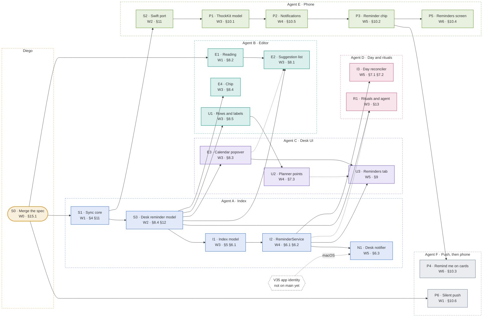

# Thock V45 - Reminders: the build plan

**Status:** Done (2026-10-22). Every module except P6 is on `v45-reminders`; P6 is on `v45-push`.
**Owner:** Diego · **Date:** 2026-10-21
**Companion docs:** `v45-reminders.md` (the spec; it wins wherever this plan disagrees), `CLAUDE.md`,
`thock/TESTING.md`

---

This plan cuts the V45 spec into 22 modules for six agents working in parallel. To take a module:
find it in §7, check that everything under **Needs** has merged into its step branch, read the spec
sections it names, and build only what its brief lists. File names marked *(new)* are suggestions.

## 1. How to read it

- **Module:** one unit of work on its own branch. The letter is the spec area: S shared, E editor,
  U desk UI, I index and day, N notifier, R rituals, P phone.
- **Wave:** the earliest a module can start, which is its longest chain of solid arrows from S0.
  Waves are an order, not equal stretches of time.
- **Needs** (solid arrow): merged into the step branch before you start.
- **Lands after** (dashed arrow): you can start sooner, but merge after it, because of a shared file
  or a hook it defines.
- **Lane:** the agent that owns the module. The lanes are cut so each one mostly owns its own files.
- **Size:** rough, S, M or L, for balancing the lanes.

## 2. Dependency graph

## 3. Lanes

| Lane | Works in | Modules, in order |
| --- | --- | --- |
| Diego | Merges, keys, releases, GUI checks | S0 |
| Agent A · Index | Rust · sync core, model, service, notifier | S1 → S3 → I1 → I2 → N1 |
| Agent B · Editor | Rust · reading, completion, chip, labels | E1 → U1 → E4 → E2 |
| Agent C · Desk UI | Rust · calendar, planner, Reminders tab | E3 → U2 → U3 |
| Agent D · Day and rituals | Rust and Markdown · day section, skills | R1, then I3 (its pure core from W3) |
| Agent E · Phone | Swift, checked on the Mac | S2 → P1 → P2 → P3 → P5 |
| Agent F · Push, then phone | Go and Swift | P6, then P4 |

## 4. Waves

| Wave | Can start | Also |
| --- | --- | --- |
| W0 | S0 | |
| W1 | S1, E1, P6 | E3's port needs nothing and can start here |
| W2 | S2, S3 | |
| W3 | I1, E2, E3, E4, U1, R1, P1 | I3's pure `reconcile` can start here |
| W4 | I2, U2, P2 | |
| W5 | I3, N1, U3, P3 | The desk is done when these land |
| W6 | P4, P5 | The phone's tail, on two agents |

The longest chain is the phone's: S0 → S1 → S2 → P1 → P2 → P3 → P4 and P5. Start S2 as soon as
S1's vectors freeze. On the desk the chain is S0 → S1 → S3 → I1 → I2, then I3, N1 and U3.

## 5. Rules for every agent

### 5.1 Branches and pull requests

CI minutes are scarce, since every PR runs macOS jobs. So modules are branches and the spec's §15
steps are pull requests, eight in all.

- **Step branches:** `v45-reminders-spec` for PR 1, `v45-step2` to `v45-step7` for PRs 2 to 7, and
  `v45-push` for PR 8. Each starts from `main`, or from an earlier step branch that holds modules it
  needs and hasn't merged yet. Merge commits keep that stack clean.
- **Module branches:** `v45/<id>-<slug>`, cut from the step branch that holds the module's needs,
  and merged into the module's own step branch after the serial check (§5.2).
- The PR that completes a step also updates the V45 entry in `VISION.md` §12, so status there
  matches `main`.

| PR | Modules | §15 step |
| --- | --- | --- |
| 1 | S0 | The spec |
| 2 | S1, S2, S3 | Sync core and desk model. S2 can follow in its own PR if the Mac is busy. |
| 3 | E1, E2, E3, E4, U1 | Desk reading |
| 4 | I1, I2, I3, U2, U3 | Desk index, tab and day |
| 5 | N1 | Desk ringing: Linux first, macOS with or after V35 |
| 6 | R1 | Rituals and agent |
| 7 | P1, P2, P3, P4, P5 | Phone. Split it if it grows. |
| 8 | P6 | Silent push, its own change. Merging deploys `thock/services/plus`. |

### 5.2 Builds

- **Rust.** Always scope cargo: `-p thock_sync_core` for S1, which builds without gpui and iterates
  fast, and `-p thock` otherwise. `thock/script/test` maps a change to its suites. Worktrees share
  one warm target dir, so builds queue on its lock and a sibling's artifacts can hide your change.
  Touch the files you changed before each check, build with `CARGO_INCREMENTAL=0`, and treat
  parallel results as advisory. The last check before a PR runs serially. See the
  `shared-target-dir-for-worktrees` memory.
- **iPhone.** This needs the Mac: `thock/ios/script/test`, a generic-simulator `xcodebuild` (ThockKit
  tests never compile the app target), and `thock/ios/script/smoke`. See `thock/TESTING.md` and the
  iOS checks note in agent memory. Say in the PR which of them ran.
- **Go.** Run `mise x -- go test ./...` in `thock/services/plus`.

### 5.3 Seams that S1 and S3 own

Pin these before wave 3, so parallel agents don't each write their own.

1. **One clock.** S3 owns an injectable wall clock with a next-midnight timer. E4 relabels chips on
   it, I3 reconciles on it, N1 schedules on it, and E1 takes `now` as an argument. The desk has no
   wall-clock scheduler today.
2. **One set of home-line edits, in the sync core.** Close, rewrite, drop and attach live in
   `reminder.rs` beside the grammar (S1), are ported to Swift (S2), and are checked by
   `fixtures/v1/reminder_edits.json`. E2, E3, I1, I2, U3, N1 and P1 call them, and nobody writes
   their own (spec §11, decision 21).
3. **One index fixture, read the same way on both sides.** `fixtures/v1/reminder_index/` is data
   only, written in S1: an index, its linked notes and a pinned time, and the reminders they yield
   with state and group. I1's pure reader and P1's `ReminderIndex` both pass it (spec §11,
   decision 22).

### 5.4 Where lanes meet

These files are touched by more than one module. Coordinate before you edit them.

| File | Modules | Why it holds |
| --- | --- | --- |
| `desk_panel.rs`, `day_plan.rs` | U1 → U2 → U3 | The arrows put them in sequence |
| `backlog_panel.rs` | U1 → U3 | In sequence |
| `reminder_service.rs` | I2, then I3 and N1 | I3 and N1 overlap in W5, and I3 only adds a trigger hook |
| `day_planner_panel.rs` | U2, I3 | The grid marker and the status row are apart |
| `backlog.rs` | U1, R1 | Row labels and the duplicate check are apart |
| keymaps (`default-linux.json`, `default-macos.json`, `vim.json`) | E3, U3 | Same lane |
| `thock.rs` | S3, I2, N1, U3 | One-line registrations |
| `Cards.swift`, `TodayScreen.swift` | P4, P5 | Two agents in W6: agree who goes first |

### 5.5 Diego's gates

- **S0:** he merges the spec, and every agent branches after it.
- **P6:** an APNs auth key, Push Notifications on the App ID, and his go-ahead for the deploy that
  merging triggers.
- **N1 on macOS:** waits for V35's release, which is on the `thock-bundle-identifier` branch.
- **GUI checks:** an agent sets up and launches the app, and Diego drives it (CLAUDE.md, Build and
  test). After PR 3: typing a token, the chip and the calendar. After PR 4: the tab, a day's
  section and planner points. After PR 5: a real ring on Linux, and whether the notification
  daemon shows the action buttons.
- **TestFlight:** a build once PR 7 is in, and only when he asks.

## 6. Already on `main`

V43's Desk tabs and Next card, V44's `ask` tool, V8's calendar sync (`calendar.rs`'s pure
`reconcile` is the pattern for I3, and `calendar_service.rs` for I2), V38 and V39 on the phone,
and gpui's system notifications (`show_system_notification`, `on_system_notification_response`,
`set_app_identity`), which no Thock code calls yet. The backend's `pusher` in
`thock/services/plus/feed.go` only logs, and nothing on the phone registers for notifications.

## 7. Module briefs

### Diego

#### S0 · Merge the spec

Diego · W0 · size S · PR 1 · spec §15.1

**Needs:** nothing · **Unblocks:** S1, E1, P6

- Commit `v45-reminders.md`, this plan and the VISION §12 entry from `v45-reminders-spec`, and merge
  the PR.
- Every agent then reads the spec from `main`.

**Files:** `thock/specs/v45-reminders.md`, `thock/specs/v45-reminders-plan.md`, `thock/VISION.md`

**Done when:** The spec is on `main`.

### Agent A · Index

#### S1 · Sync core: grammar, edits and vectors

Agent A · Index · W1 · size L · PR 2 · spec §4, §5.2, §7.1, §11

**Needs:** S0 · **Unblocks:** S3, S2

- Token, struck token and id grammar (§4.1): real calendar dates, `H:MM` read and `HH:MM` written,
  ids of 12 lowercase hex digits.
- Where a token counts (§4.2): in-scope paths only (not `.thock/`, the templates folder or
  `routines/`); not in inline code, fences, front matter, HTML comments or after `\`; the last token
  on a line wins; never on a `<!--gcal:` line.
- The daily-path day rule: read a stem back through the moment-style `[daily] filename`
  (`YYYY-MM-DD`, `YYYYMMDD_MMM-ddd`). A format with no year, month or day token never resolves.
- Mirror-line recognition, including the carried due (§7.1), and state derivation: open, closed,
  dropped (§5.2).
- The home-line edits every writer makes (§11, decision 21): close (tick a task, strike the token in
  prose), rewrite the token (the full date unless the home is the new day's daily note), drop the
  token and keep the id, attach a token and a new id. The tab, the notifier, the index service and
  the phone all call these.
- Vectors in `fixtures/v1/reminders.json`, `daily_paths.json` and `reminder_edits.json`, read by
  `tests/fixtures.rs`. Add the V34 API §7 note and the §9 vector list. `line_hash` and
  `WRITE_VERSION` stay as they are.
- The index fixture in `fixtures/v1/reminder_index/` (decision 22), data only: an index, the notes
  it links to and a pinned time, and the reminders they yield with their state and group (Overdue,
  Today, Upcoming, Done). Build the first case from the §5.1 example.

**Files:** `crates/thock-sync-core/reminder.rs` *(new)*,
`crates/thock-sync-core/thock_sync_core.rs`, `crates/thock-sync-core/tests/fixtures.rs`,
`crates/thock-sync-core/fixtures/v1/reminders.json` *(new)*,
`crates/thock-sync-core/fixtures/v1/daily_paths.json` *(new)*,
`crates/thock-sync-core/fixtures/v1/reminder_edits.json` *(new)*,
`crates/thock-sync-core/fixtures/v1/reminder_index/` *(new)*, `thock/specs/v34-vault-sync-api.md`

**Done when:** Every §14 Grammar and Line edits case is a vector and passes: a token in code, after
a backslash, two tokens on a line, a struck token, time-only in and out of a daily note under two
filename formats, a `<!--gcal:` line, ids after other trailing comments, mirror lines, and each edit
on each §4.4 line shape.

**Note:** Freeze the vectors and the index fixture early: S2 ports against them, S3 and every desk
writer build on the API, and I1 and P1 read the fixture.

#### S3 · Desk reminder model

Agent A · Index · W2 · size M · PR 2 · spec §8.4, §12

**Needs:** S1 · **Unblocks:** I1, E2, E3, E4, U1, R1

- `ReminderSettings` from `.thock/reminders.toml`: index path, the three headings, ring times and
  `desk`. A missing file means the defaults.
- Chip label and state for a reminder at a given now: upcoming, today, overdue, closed, no day.
  *Today*, *Tomorrow*, *Yesterday*, otherwise `ddd D MMM` (with the year when it isn't this year),
  through `notes::format_date`. The state also places a reminder in Overdue, Today, Upcoming or
  Done, which the index fixture checks.
- One injectable wall clock with a next-midnight timer, shared by the chip, the day reconciler and
  the notifier. Nothing like it exists today; every loop is a relative timer.

**Files:** `crates/thock/src/reminders.rs` *(new)*, `crates/thock/src/thock.rs`

**Done when:** Unit tests for settings defaults and overrides, and every chip state and label.

**Note:** Most desk modules call these functions. Pinning them first keeps parallel agents from
writing their own versions.

#### I1 · Index model (pure)

Agent A · Index · W3 · size L · PR 4 · spec §5, §6.1 steps 1–7

**Needs:** S3 · **Unblocks:** I2

- Parse `reminders.md`: `## Open` and `## Done` matched loosely (V26), link lines, loose lines, and
  the `✅`, `dropped` and `removed` stamps. Write the skeleton on first use.
- A pure batch step from the index, the appearances in changed files and now, to line edits: assign
  ids (draw again on a collision), append links, retarget a moved link, mark removed after a
  10-second grace, move entries between Open and Done with stamps, apply copy ticks to the home line
  (the latest change wins), re-append a link deleted by hand.
- Edits are appends, moves and single-line replaces. The file is never sorted or rewritten.
- A pure reader from the index and its linked files' text to reminders with their home line, state
  and group. I2's reading API wraps it with buffers and `Fs`.

**Files:** `crates/thock/src/reminder_index.rs` *(new)*

**Done when:** Pure tests for each step: one link per reminder, a move retargets, removed after the
grace, dropped, a copy tick, link repair, a loose phone line taken as it is. The reader passes every
`fixtures/v1/reminder_index/` case.

#### I2 · ReminderService

Agent A · Index · W4 · size L · PR 4 · spec §6.1, §6.2

**Needs:** I1 · **Unblocks:** I3, N1, U3 · **Lands before:** R1

- One entity per vault: a global map from the canonical vault root to a weak handle. Two windows
  share it.
- It runs on worktree events for in-scope Markdown, on its own writes, at startup and on
  `thock::RebuildReminders`. Batches are 500 ms; an open buffer waits for two idle seconds and skips
  the cursor's line.
- Writes go through the open buffer as one undoable transaction, otherwise through `Fs`. A failed
  write shows a Reminders row with Retry in the sync status popover (V32).
- `.thock/cache/reminders/scan.json` re-parses only files whose mtime changed. The first run scans
  the vault once.
- The reading API for every desk reader wraps I1's pure reader: the index, then each linked file by
  buffer or `Fs`, cached by mtime. A missing line reads as *line not found* until a move settles.

**Files:** `crates/thock/src/reminder_service.rs` *(new)*, `crates/thock/src/sync_status.rs`,
`crates/thock/src/thock.rs`

**Done when:** §14 Index service with a fake `Fs`: the id lands after idle and off the cursor's
line, a cut and paste retargets, removed after the grace, dropped, a copy tick, a hand-deleted link
returns, startup re-parses only changed files, two workspaces share one service.

#### N1 · Desk notifier

Agent A · Index · W5 · size M · PR 5 · spec §6.3

**Needs:** I2 · **Lands after:** V35 · **Unblocks:** nothing

- One timer to the next due instant plus a 60-second check for sleep and clock changes. A date-only
  reminder is due at `date_only_at`.
- `cx.show_system_notification` with tag `rem:<id>:<due>`, the text trimmed to 80 characters as the
  title, `14:30 · projects/house` as the body, and *Done*, *In 1 hour* and *Tomorrow 09:00*. Answers
  edit the home line with the sync-core edits.
- `.thock/cache/reminders/fired.json` keeps a restart from ringing twice. One summary covers what
  came due while Thock was closed. `[ring] desk = false` stays silent.
- Call `set_app_identity` at startup on both platforms; nothing calls it today. Linux first, macOS
  with or after V35.

**Files:** `crates/thock/src/reminder_notifier.rs` *(new)*, `crates/thock/src/reminder_service.rs`,
`crates/thock/src/thock.rs`

**Done when:** §14 Notifier on the test platform and clock: rings at the due minute, date-only at
`date_only_at`, no repeat after a restart, one summary, each answer edits the home line, `desk =
false` stays silent. `set_app_identity` is called first.

**Note:** macOS ringing waits for V35, which lives on the `thock-bundle-identifier` branch and ships
as a deliberate release.

### Agent B · Editor

#### E1 · Natural-language reading

Agent B · Editor · W1 · size M · PR 3 · spec §8.2

**Needs:** S0 · **Unblocks:** E2

- A pure function of the query and the clock in `reminder_reading.rs`, returning readings soonest
  first.
- Every §8.2 row: `today`/`tod`, `tomorrow` forms, weekdays (never today), `next mon`, `next week`,
  `dec 2` and `2 dec`, ISO dates, `in 2h` to `in 2 weeks`, `10:30`, `9am`, bare hours (both
  readings), `morning` to `tonight`.
- A time already past rolls to tomorrow, marked *already past* when the day was named. Unknown words
  are ignored and named beside the first reading (*ignores "foo"*).

**Files:** `crates/thock/src/reminder_reading.rs` *(new)*

**Done when:** Every §8.2 row at a pinned clock, a bare hour on both sides of noon, *already past*
and unknown words.

**Note:** Needs nothing from the rest of V45. Start on day one.

#### E2 · Suggestion list

Agent B · Editor · W3 · size M · PR 3 · spec §8.1

**Needs:** S3, E1 · **Lands after:** E3 · **Unblocks:** nothing

- A reminder branch in the `[[` and `![` completion provider: an open `(@` before the cursor with no
  `)` between, outside code and off calendar lines. Markdown's autoclosed `)` is part of the
  replaced range.
- Items are the readings, then *Pick a date…*. An empty query offers *Later today 17:00* (before
  16:00), *Tomorrow 09:00* and *Monday 09:00*. A query with no reading returns no items, so `enter`
  breaks the line.
- Responses are incomplete and every item's filter text is the query, so the fuzzy filter keeps *Wed
  2 Dec* for `dec 2`.
- Accepting writes the canonical token from the sync core; `esc` leaves the typed text. The list
  never takes focus; `ctrl-n` and `ctrl-p` move through it in vim insert mode.

**Files:** `crates/thock/src/wikilink_completion.rs`

**Done when:** §14 Completion: `(@` starts a query, `dec 2` survives the filter, `tab` writes the
full date in `projects/house.md` and `(@10:00)` in that day's note, a query with no reading closes
the list, no list in code or on a calendar line.

**Note:** *Pick a date…* dispatches `thock::PickReminderDate`, which E3 defines, so E2 lands after
E3.

#### E4 · The chip

Agent B · Editor · W3 · size M · PR 3 · spec §8.4

**Needs:** S3 · **Unblocks:** nothing

- `SpanKind::Reminder` carries the chip's label and state. Today `SpanKind` is a payload-free `Copy`
  enum and `collapsed_text_for` picks placeholders by kind.
- The fold diff keys on range and label. The placeholder is a `FoldPlaceholder` render with
  `constrain_width: false`. No upstream change.
- The five states come from S3. The cursor's line shows the source, and labels recompute at midnight
  on S3's clock.

**Files:** `crates/thock/src/markdown_syntax.rs`, `crates/thock/src/markdown_conceal.rs`

**Done when:** §14 Chip on the conceal harness: each state folds to its label, the cursor's line
shows the source, the buffer is never modified, the label changes at midnight.

#### U1 · Rows outside the editor

Agent B · Editor · W3 · size M · PR 3 · spec §8.5, §4.3

**Needs:** S3 · **Unblocks:** U2

- Planner labels, the Next card, Backlog rows, Done rows and `markdown_text.rs` drop the token and
  every trailing comment. Today the backlog row and the planner label strip only one.
- The row's meta line shows the chip from S3: *Renew passport* over *⏰ Wed 2 Dec · 09:00*.

**Files:** `crates/thock/src/markdown_text.rs`, `crates/thock/src/day_plan.rs`,
`crates/thock/src/desk_panel.rs`, `crates/thock/src/backlog.rs`, `crates/thock/src/backlog_panel.rs`

**Done when:** Label tests for a token followed by several trailing comments in each row type, and a
backlog row that shows the meta chip.

**Note:** Do it first in wave 3: U2 in lane C waits on it.

### Agent C · Desk UI

#### E3 · Calendar popover

Agent C · Desk UI · W3 · size L · PR 3 · spec §8.3

**Needs:** S3 · **Unblocks:** U3 · **Lands before:** E2

- Port gpui-kit's calendar into `ui/calendar.rs` with the Apache-2.0 notice and the source path, as
  V41 ported the split. Share its day model with the masthead's two-week strip.
- Key context `ThockReminderCalendar`, and it takes focus: arrows or `h` `j` `k` `l` move the day or
  week, `[` and `]` change month, digits type the time, `backspace` clears it, `enter` accepts,
  `esc` goes back to the list.
- `thock::PickReminderDate` opens it at the cursor from the palette or a binding, starting on the
  date of the line's existing token.
- Bindings in `default-linux.json`, `default-macos.json` and `vim.json`.

**Files:** `crates/thock/src/ui/calendar.rs` *(new)*, `crates/thock/src/ui.rs`,
`crates/thock/src/masthead.rs`, `assets/keymaps/default-linux.json`,
`assets/keymaps/default-macos.json`, `assets/keymaps/vim.json`

**Done when:** A keystroke test: open, move, type a time, accept writes the token;
`PickReminderDate` on a line with a token starts on its date; `esc` returns focus.

**Note:** The port itself needs nothing. Start it in wave 1 while S1 and S3 land.

#### U2 · Planner points and the Next card

Agent C · Desk UI · W4 · size M · PR 4 · spec §7.3

**Needs:** U1 · **Unblocks:** nothing · **Lands before:** U3

- `day_plan.rs` items gain an optional reminder time. Mirror lines are recognised by id under the
  Reminders subsection, and a token time on a planner line adds a point.
- A bell marker on the Day Planner grid instead of a 30-minute block. Carried mirrors read *from Tue
  20 Oct* in the warning colour.
- The Next card counts down to points (*Next · in 25 min · 14:30 · Call the plumber*) and never
  calls one *Now*.

**Files:** `crates/thock/src/day_plan.rs`, `crates/thock/src/day_planner_panel.rs`,
`crates/thock/src/desk_panel.rs`

**Done when:** §14 Planner: labels stripped, a mirror line is a point, a token time adds a point,
the Next card counts down to a point and never says *Now*.

#### U3 · The Reminders tab

Agent C · Desk UI · W5 · size L · PR 4 · spec §9

**Needs:** I2, E3 · **Lands after:** U2 · **Unblocks:** nothing

- `DeskTab::Reminders`: Backlog · Today · Reminders · Done on `1`–`4` (Done moves to `4`), `g t` and
  `g shift-t` cycle, `ActivateDeskTab { tab: "reminders" }`.
- Overdue, Today and Upcoming, sorted by due. The tab's count is the overdue number in the warning
  colour. Done adds closed and dropped reminders from `## Done` beside closed backlog tasks.
- Key context `ThockRemindersPanel` plus `menu`, a visible selection kept by id across reloads.
  `enter` opens the line, `x` or `space` closes, `s` opens the reschedule menu (`1`–`3`, *Pick a
  date…*), `d` drops, `o` starts a new line in `reminders.md`, `escape` goes back.
- `thock::ToggleRemindersFocus` on `ctrl-alt-r` and `cmd-alt-r` in the Workspace context;
  `RebuildReminders` stays palette-only. Doc comments are written for a note-taker; vim motions go
  in `vim.json`.

**Files:** `crates/thock/src/reminders_panel.rs` *(new)*, `crates/thock/src/desk_panel.rs`,
`crates/thock/src/backlog_panel.rs`, `crates/thock/src/thock.rs`,
`assets/keymaps/default-linux.json`, `assets/keymaps/default-macos.json`, `assets/keymaps/vim.json`

**Done when:** §14 Reminders tab with `simulate_keystrokes` under `MultiWorkspace::test_new`:
motions, `x`, `s` then `1`, `d`, `enter`, the selection survives a file event, `3` and `4` reach
their tabs, `escape` returns focus.

### Agent D · Day and rituals

#### R1 · Rituals and the agent

Agent D · Day and rituals · W3 · size M · PR 6 · spec §13, §12

**Needs:** S3 · **Lands after:** I2 · **Unblocks:** nothing

- Week Review sweep before the backlog offer: every open reminder due by the end of this ISO week,
  earlier weeks included. One `ask` (*Move all to Mon 09:00*, *Let me pick*, *Leave them*), then
  per-reminder choices. Write only home lines found by id, never `reminders.md`.
- Wrap Today and Wrap Yesterday ask once about the day's leftovers. `# Daily Closure` quotes drop
  the token and id. Carrying a task to the backlog keeps both, and the duplicate check ignores them,
  in the skill text and in `backlog.rs`'s normalization.
- An `AGENTS.md` section. The hosted agent's context block names the index path beside the backlog
  file; if phone Ask builds its own block, mirror it in `ThockKit/Ask`. `set-language.md` learns the
  three headings.
- A test that parses every line shape the skills tell the agent to write, using the sync-core
  grammar.

**Files:** `crates/thock/assets/routines/timeline/skills/week-review.md`,
`crates/thock/assets/routines/timeline/skills/wrap-today.md`,
`crates/thock/assets/routines/timeline/skills/wrap-yesterday.md`, `crates/thock/assets/AGENTS.md`,
`crates/thock/assets/skills/set-language.md`, `crates/thock/src/hosted_agent.rs`,
`crates/thock/src/backlog.rs`

**Done when:** The ritual test passes, and the backlog duplicate tests cover a token and an id.

**Note:** It can be written from wave 3 but lands after I2, so the sweep has an index to read.

#### I3 · Day reconciler

Agent D · Day and rituals · W5 · size L · PR 4 · spec §7.1, §7.2

**Needs:** I2 · **Unblocks:** nothing

- A pure `reconcile` like `calendar.rs`'s. Mirror lines are planner lines with the time first,
  ordered timed, then untimed, then carried. Insert and replace only, never delete.
- Carried reminders appear only in today's note, marked with their due. Reminders whose home is this
  note are not repeated, and past days are left alone.
- Replace on a home change. Freeze a line the person edited and log it to
  `.thock/cache/reminders/log.jsonl`. Strike with `→ date` on a move and restore on a move back.
  Tick on close. Strike with `(dropped)` or `(removed)`.
- Triggers: `ensure_note_at` tells the service, a file event for a note the phone made, an index
  change, midnight, startup. It never creates a note. With no planner heading it holds, and the Day
  Planner status row offers *Add heading*.

**Files:** `crates/thock/src/reminder_day.rs` *(new)*, `crates/thock/src/reminder_service.rs`,
`crates/thock/src/notes.rs`, `crates/thock/src/day_planner_panel.rs`

**Done when:** §14 Day reconciler, pure: insert order, replace, freeze, strike on a move, tick on
close, carried only in today's note, no repeats, never a delete, the hold.

**Note:** The pure `reconcile` needs only S1 and S3. Start it in wave 3 and wire the triggers when
I2 lands.

### Agent E · Phone

#### S2 · Swift port of the sync core

Agent E · Phone · W2 · size M · PR 2 · spec §10.1, §11

**Needs:** S1 · **Unblocks:** P1

- Port `reminder.rs`, the grammar and the edits, to `ThockKit/SyncCore/Reminder.swift` with the same
  API shape.
- Copy the new vectors and the index fixture into `ThockKitTests/Fixtures/v1`, and read the vectors
  in `SyncCoreFixtureTests.swift` like `hashes.json` and `paths.json`. P1 reads the index fixture.

**Files:** `thock/ios/ThockKit/Sources/ThockKit/SyncCore/Reminder.swift` *(new)*,
`thock/ios/ThockKit/Tests/ThockKitTests/SyncCoreFixtureTests.swift`,
`thock/ios/ThockKit/Tests/ThockKitTests/Fixtures/v1/`

**Done when:** `thock/ios/script/test` on the Mac passes the same vectors as the Rust runner.

**Note:** Start the moment S1's vectors freeze. The phone lane is the longest chain in the plan.

#### P1 · ThockKit reminder model

Agent E · Phone · W3 · size M · PR 7 · spec §10.1

**Needs:** S2 · **Unblocks:** P2

- `ReminderIndex` reads `reminders.md` and the linked files from the local store and derives state
  from home lines, as the desk does. It passes every `fixtures/v1/reminder_index/` case.
- Read `.thock/reminders.toml` through `VaultConfig`: `date_only_at`, `snooze_minutes`,
  `tomorrow_at` and the headings.
- Write builders in `PhoneWrites` wrap S2's ported edits in the phone's write kinds: the capture
  `append` under `## Open` with children (V38, V39), the *Remind me…* `replace_line` plus link
  `append`, and a tick, strike, rewrite or drop as a `replace_line`. A new id checks the index for
  collisions.
- Display text drops tokens and every trailing comment; chip label and state; the editor keeps a
  token and its id through an edit.

**Files:** `thock/ios/ThockKit/Sources/ThockKit/Vault/ReminderIndex.swift` *(new)*,
`thock/ios/ThockKit/Sources/ThockKit/Vault/PhoneWrites.swift`,
`thock/ios/ThockKit/Sources/ThockKit/Vault/VaultConfig.swift`,
`thock/ios/ThockKit/Sources/ThockKit/Editor/`

**Done when:** ThockKit tests: each builder emits exactly the expected write, every index fixture
case yields the expected reminders and groups, an editor round trip keeps the token and id.

#### P2 · Phone notifications

Agent E · Phone · W4 · size M · PR 7 · spec §10.5

**Needs:** P1 · **Unblocks:** P3

- `UNUserNotificationCenter` calendar triggers in local time for the soonest 64 open reminders,
  refreshed after every store change and every return to the foreground. Identifiers are
  `rem:<id>:<due>`, so a refresh replaces only what changed.
- A `thock.reminder` category with *Done*, *In 1 hour* and *Tomorrow 09:00*, handled in the
  background: one store write, then a sync under a background task.
- Ask for permission the first time the chip or *Remind me…* is used, never at launch.

**Files:** `thock/ios/ThockKit/Sources/ThockKit/Vault/ReminderSchedule.swift` *(new)*,
`thock/ios/Thock/ThockApp.swift`, `thock/ios/Thock/AppModel.swift`

**Done when:** The schedule picks the soonest 64 and replaces only what changed; each action records
exactly one write.

**Note:** Keep the choice of 64 and the diffing in ThockKit so `swift test` covers it; only the
`UNUserNotificationCenter` calls live in the app.

#### P3 · Reminder chip and the Remind me sheet

Agent E · Phone · W5 · size M · PR 7 · spec §10.2

**Needs:** P2 · **Unblocks:** P4, P5

- `CaptureDestination.reminder`, a fourth chip after Today, Inbox and Backlog. `chip(for:)` never
  returns it, and saving keeps the previous chip.
- *Remind me*, a sibling of `SetTimeSheet` at 360 points: *Later today 17:00* (before 16:00),
  *Tomorrow 09:00*, *Next week Mon 09:00*, and *Date and time* with a 24-hour `.hourAndMinute`
  picker and *No time*.
- The chip reads its time (*⏰ Thu 10:00*) and the hint reads *Rings Thursday at 10:00 and waits in
  reminders.md.* Save appends through P1 and schedules at once. With permission denied it still
  saves and the sheet says notifications are off.

**Files:** `thock/ios/Thock/CaptureSheet.swift`, `thock/ios/Thock/Sheets.swift`,
`thock/ios/Thock/AppModel.swift`, `thock/ios/ThockKit/Sources/ThockKit/Vault/PhoneWrites.swift`

**Done when:** ThockKit: the `.reminder` capture emits one `append` with a token and an id, and
`chip(for:)` never returns `.reminder`. On the Mac: simulator build and smoke.

#### P5 · Reminders screen and the Today row

Agent E · Phone · W6 · size L · PR 7 · spec §10.4

**Needs:** P3 · **Unblocks:** nothing

- Today gains *REMINDERS · 2 overdue · 3 today ›* (or *nothing due*) under the planner card. The
  planner card shows mirror lines, with carried ones marked *from Tue*.
- The screen opens the way Backlog does (`showingReminders`, `thock://reminders`): *‹ Today*, then
  Overdue, Today and Upcoming, with Done folded (*Done · 2 this week ›*).
- Swipe right closes, swipe left reschedules through the sheet, a long press offers *Reschedule…*,
  *Open note* and *Drop the reminder*. Each is one write with Undo, as in V38.

**Files:** `thock/ios/Thock/RemindersScreen.swift` *(new)*, `thock/ios/Thock/TodayScreen.swift`,
`thock/ios/Thock/AppModel.swift`, `thock/ios/Thock/RootView.swift`, `thock/ios/Thock/Cards.swift`

**Done when:** The screen's groups come from P1's `ReminderIndex`, each gesture records one write,
and the simulator build and smoke pass.

### Agent F · Push, then phone

#### P6 · Silent push

Agent F · Push, then phone · W1 · size M · PR 8 · spec §10.6, §15.7

**Needs:** S0 · **Unblocks:** nothing

- A real APNs client (HTTP/2 with a token-based key) behind the existing `pusher` interface in
  `thock/services/plus/feed.go`, which only logs today.
- The `aps-environment` entitlement in `Config/Thock.entitlements` and token registration in the
  app, so a desk write wakes the phone to sync.
- Its own PR. Merging deploys `thock/services/plus`; say so in the PR.

**Files:** `thock/services/plus/feed.go`, `thock/services/plus/main.go`,
`thock/ios/Config/Thock.entitlements`, `thock/ios/Thock/ThockApp.swift`

**Done when:** Go tests against a fake APNs endpoint, the app registers its token, and an end-to-end
check on a device.

**Note:** Needs nothing from V45, but it needs Diego: an APNs auth key and Push Notifications on the
App ID.

#### P4 · Remind me… on cards and planner rows

Agent F · Push, then phone · W6 · size S · PR 7 · spec §10.3

**Needs:** P3 · **Unblocks:** nothing

- Backlog cards and planner rows gain *Remind me…* beside *Set a time…*, opening the same sheet.
- One `replace_line` appends the token and a new id; one `append` adds `- [[<note>]]
  <!--rem:<id>-->` under `## Open`.
- Cards and rows draw the chip and drop tokens and comments from their text.

**Files:** `thock/ios/Thock/Cards.swift`, `thock/ios/Thock/BacklogScreen.swift`,
`thock/ios/Thock/TodayScreen.swift`

**Done when:** *Remind me…* emits a `replace_line` and an `append`; simulator build and smoke pass.

**Note:** Agent F takes this once P6 is in, so the phone's last wave runs on two agents.
